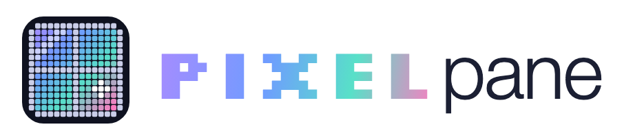
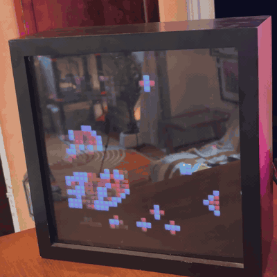
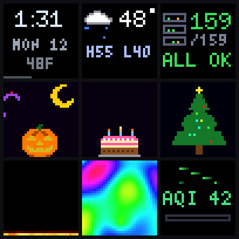
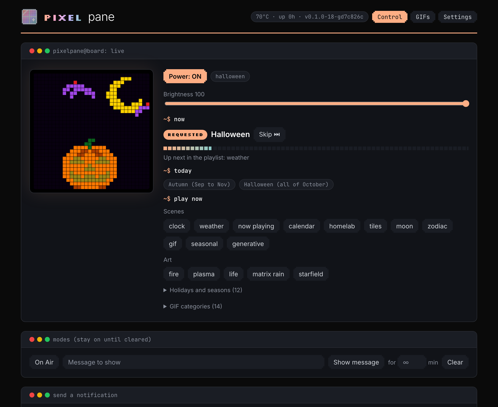
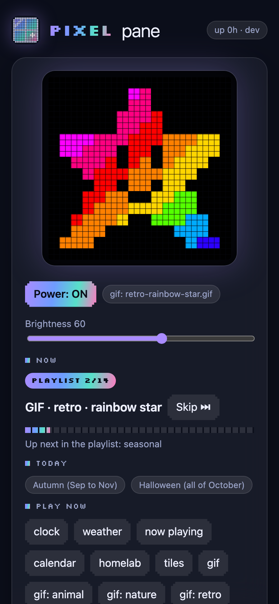
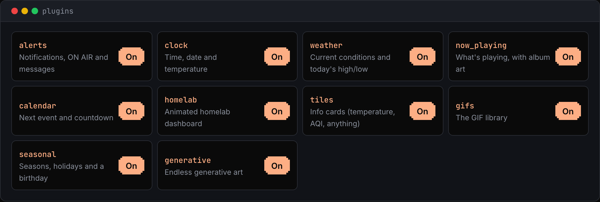

<p align="center">
  <picture>
    <source media="(prefers-color-scheme: dark)" srcset="docs/images/logo-dark.png">
    
  </picture>
</p>

<p align="center"><b>A 32x32 LED art pane for your wall, driven by a Raspberry Pi.</b></p>

<p align="center">
  <a href="https://github.com/JoeKarlsson/pixelpane/actions/workflows/ci.yml"></a>
  <a href="LICENSE"></a>
  
</p>

It mixes pixel-art
GIFs with live, animated scenes: a clock, weather, what's playing (with album
art), your next meeting, a homelab dashboard, seasonal and holiday animations,
and generative art. Home Assistant can push notifications to it (doorbell,
laundry, weather warnings) and control it like a light. Everything is a plugin,
in the spirit of MagicMirror.

<p align="center"></p>

What it shows, panel's-eye view:



| Control page | On a phone |
|---|---|
|  |  |

## What it does

- **Scenes, not just a slideshow.** A playlist mixes GIFs with live scenes. A
  scene with nothing to show (no music playing, no meeting soon) is skipped.
- **Everything animates.** Icons ring, hop and spin; gauges fill; the homelab
  dashboard cycles through six animated pages.
- **Seasons and holidays.** Autumn leaves, snow, flowers, beach days, Halloween,
  Thanksgiving, Christmas, New Year, Valentine's, St. Patrick's, the Fourth of
  July and your birthday, each with a scene and its own GIF folder.
- **A web control page** with a live preview, a "now playing" view that follows
  the playlist, a playlist editor, GIF library
  (upload converts anything to 32x32) and plugin switches.
- **An HTTP API** for notifications, modes (ON AIR, messages) and data.
- **Home Assistant ready**: a light entity, a feed automation and notification
  examples in [docs/HOME_ASSISTANT.md](docs/HOME_ASSISTANT.md).
- **Appliance-grade setup**: one idempotent installer, unattended security
  updates, logs in RAM, runs unprivileged, survives power cuts.

## Build one

You need a Raspberry Pi, an Adafruit RGB Matrix HAT (or Bonnet), a 32x32 HUB75
panel, a 5 V 4 A power supply and, for the finished look, a shadow box with a
3D-printed light grid behind a two-way mirror. The full parts list, diagrams and
assembly steps are in **[docs/HARDWARE.md](docs/HARDWARE.md)**.

| Pi | Driver | Status |
|----|--------|--------|
| Pi 3 B / 3 B+ | hzeller/rpi-rgb-led-matrix | the reference build |
| Pi 4, Zero 2 W | hzeller/rpi-rgb-led-matrix | supported (set `gpio_slowdown` if it flickers) |
| Pi 5 | Adafruit PioMatter | supported in code, picked automatically; not yet tested on hardware |

## Install

1. Flash **Raspberry Pi OS Lite (64-bit)** with Raspberry Pi Imager. In its
   settings set a hostname, a user, your SSH public key, Wi-Fi and its country.
2. On your computer, clone this repo and run the deploy script:

   ```bash
   git clone https://github.com/JoeKarlsson/pixelpane && cd pixelpane
   PIXELPANE_HOST=pi@pixelpane.local PIXELPANE_TZ=America/Chicago tools/deploy.sh
   ```

   It copies the code to the Pi and runs `install.sh`, which builds the LED
   driver (about 10 minutes on a Pi 3), installs the service and hardens the
   box. Run it again any time; it only changes what changed.
3. Reboot once if it says `REBOOT NEEDED`, then open `http://pixelpane.local/`.
4. Add GIFs: see **[docs/GIFS.md](docs/GIFS.md)** for where to find them and
   how to make your own. Upload them on the page, or keep a library folder and
   deploy it (below).

### Keeping your own stuff out of the repo

Put your GIFs and settings in a sibling folder, by default
`../pixelpane-library`:

```
pixelpane-library/
  gifs/                 all-year GIFs, named <category>-<what-it-shows>.gif
  gifs/themes/<theme>/  seasonal GIFs (halloween, winter, birthday, ...)
  deploy.env            PIXELPANE_HOST=..., PIXELPANE_KEY=..., PIXELPANE_TZ=..., PIXELPANE_WIFI_COUNTRY=...
```

`tools/deploy.sh` picks it up automatically (`PIXELPANE_LIBRARY` points elsewhere).

## Plugins

| Plugin | Scenes | Takes data |
|--------|--------|------------|
| clock | clock | |
| weather | weather (+ Open-Meteo fallback) | `weather` |
| now_playing | now_playing, with album art | `now_playing` |
| calendar | calendar, with a countdown | `next_event` |
| homelab | a six-page animated dashboard | `homelab` |
| tiles | info cards with animated icons and gauges | `tiles` |
| alerts | notify, on_air, message | |
| gifs | gif, gif:&lt;category&gt; | |
| seasonal | a scene per season and holiday, plus your birthday | |
| generative | fire, plasma, life, matrix_rain, starfield | |
| sky | moon (phase, named full moons, supermoons, blue moons), zodiac | |

Switch plugins on or off on the control page, or in the config. Writing your
own takes one Python file: see **[docs/PLUGINS.md](docs/PLUGINS.md)**.



## Configuration

Settings live on the Pi in `/var/lib/pixelpane/config.json` and are edited from
the page or `PUT /api/config`. Defaults are in
[`pixelpane/default_config.json`](pixelpane/default_config.json). An example:

```json
{
  "brightness": 60,
  "rotation": ["clock", "gif", "seasonal", "weather", "gif:retro", "homelab"],
  "dwell": {"gif": 20, "clock": 10},
  "plugins": {
    "seasonal": {"birthday": {"month": 4, "day": 13, "name": "Joe"}},
    "weather": {"latitude": 51.5, "longitude": -0.12},
    "now_playing": {"art_hosts": ["http://homeassistant.local:8123/"]},
    "generative": {"enabled": false}
  },
  "display": "auto",
  "adafruit_board": "hat"
}
```

## API

LAN only, no authentication: keep the board on your home network.

| Call | Body | Does |
|------|------|------|
| `GET /api/health` | | power, scene, themes, temperature, throttle flags, version |
| `GET /api/state` | | the above plus plugins, scenes, icons, data ages |
| `POST /api/state` | `{"power": true, "brightness": 40}` | on/off, brightness 1-100 |
| `POST /api/notify` | `{"text": "Doorbell", "icon": "bell", "color": "#ffcc00", "flash": true, "seconds": 10}` | a message that jumps the queue |
| `POST /api/pin`, `DELETE /api/pin` | `{"scene": "on_air", "minutes": 30}` | hold a scene, or clear it |
| `POST /api/skip` | | end the current scene (never a notification) |
| `POST /api/play` | `{"scene": "halloween"}` or `{"scene": "gif:retro"}` | play next |
| `POST /api/data/<key>` | see each plugin | feed a scene |
| `GET/PUT /api/config` | any config key, merged | playlist, timings, plugin settings |
| `GET /api/gifs`, `POST /api/gifs`, `DELETE /api/gifs/<id>` | multipart `file`, `theme` | the GIF library |
| `GET /preview.png?scale=10` | | the current frame |

Icons for `notify` and tiles: bell, mail, alert, check, heart, door, music,
calendar, package, home, lock, washer, thermometer, drop, info, camera, car,
cat, air.

## Development

```bash
python3 -m venv .venv && .venv/bin/pip install flask pillow numpy
PIXELPANE_FAKE=1 PIXELPANE_HOME=. PIXELPANE_STATE=/tmp/gb .venv/bin/python -m pixelpane.app --port 8080
.venv/bin/python -m pixelpane.preview sheet /tmp/scenes.png halloween clock homelab   # look at scenes
PYTHON=.venv/bin/python tools/test.sh   # backend unittest + Playwright tests of the page
```

`PIXELPANE_FAKE=1` runs everything without a panel. Tests are plain `unittest`
for the backend (they also run on the Pi) and Playwright for the page, which
clicks every button against the real server. See [CONTRIBUTING.md](CONTRIBUTING.md).

## Layout

```
pixelpane/            the controller: app (player), web (API + page), state, display, kit (scene toolkit)
pixelpane/plugins/    the built-in plugins
pixelpane/fonts/      BDF fonts (public domain, tom-thumb MIT)
install.sh           idempotent installer and hardening, runs on the Pi
tools/               deploy.sh, ingest-gif.sh, test.sh
hardware/            led-grid.scad, the parametric 3D-printed light grid
docs/                hardware, plugins, Home Assistant, GIFs
tests/               backend tests and tests/frontend (Playwright)
```

## Credits

- [hzeller/rpi-rgb-led-matrix](https://github.com/hzeller/rpi-rgb-led-matrix) (GPL-2.0), the LED driver for Pi 2-4, built by the installer.
- [Adafruit PioMatter](https://github.com/adafruit/Adafruit_Blinka_Raspberry_Pi5_Piomatter), the Pi 5 driver.
- [Silkscreen](https://github.com/googlefonts/silkscreen) by Jason Kottke for the web page (SIL OFL 1.1).
- [Inter](https://github.com/rsms/inter) and [JetBrains Mono](https://github.com/JetBrains/JetBrainsMono) for the web page (SIL OFL 1.1). The page's look follows [joekarlsson.com](https://www.joekarlsson.com).
- Fonts from the X11 misc-fixed set (public domain) and [tom-thumb](https://robey.lag.net/2010/01/23/tiny-monospace-font.html) by Robey Pointer (MIT).

## Name

PixelPane started life in 2020 as *Graffiti Board*, a live collaborative drawing
wall. It grew into a wall display, and the name grew with it.

## License

MIT. See [LICENSE](LICENSE).
