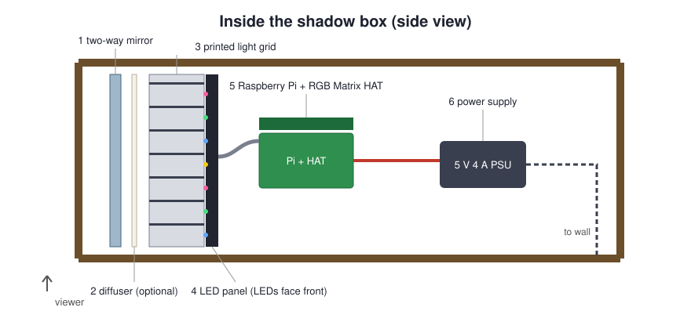
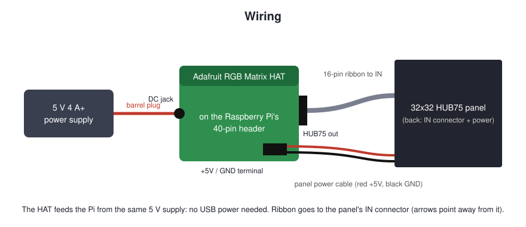

# Building a PixelPane

The finished board is a shadow box on the wall. From the front you see a dark
mirror; when it lights up, each LED shows through as a crisp square pixel. Inside
is a 32x32 LED panel, a 3D-printed light grid, a Raspberry Pi with an LED driver
HAT, and one power supply.

## Parts

| Part | What to get | Notes |
|------|-------------|-------|
| Raspberry Pi | Pi 3 B/B+, Pi 4, Zero 2 W or Pi 5 | Pi 3 is the reference build. 1 GB of RAM is plenty |
| LED driver | Adafruit RGB Matrix **HAT** (or the smaller **Bonnet**) | Sits on the Pi's 40-pin header and powers the Pi too |
| LED panel | 32x32 RGB **HUB75** panel | Comes in pitches: P4 (128 mm square), P5 (160 mm), P6 (192 mm). Usually ships with a ribbon and a power cable |
| Power | 5 V, **4 A or more**, barrel plug for the HAT | A 32x32 panel can draw up to about 4 A at full white |
| SD card | 16 GB or more, A1 class | |
| Heatsink | Any stick-on Pi heatsink | The LED driver keeps one CPU core busy; a bare Pi 3 runs at 70-75 C |
| Shadow box | Picture-frame style, at least 50 mm deep inside, sized to the panel | Deep frames from craft stores work |
| Light grid | 3D printed from [`hardware/led-grid.scad`](../hardware/led-grid.scad) | Black or dark grey PLA hides best |
| Front | Two-way mirror acrylic (2-3 mm), cut to the frame | Smoked acrylic or mirror window film on clear acrylic also works |
| Diffuser (optional) | Tracing paper, frosted film or a thin white acrylic sheet | Softens the LED hot spots inside each square |
| Bits | M2.5 standoffs, a few M3 screws for the panel's magnets or holes, cable ties | |

## Wiring

1. Seat the HAT on the Pi's 40-pin header (on a Pi 3 or 4, a standoff under the
   far corner keeps it level).
2. Connect the 16-pin ribbon from the HAT's output to the panel's **IN**
   connector. The small arrows printed on the panel's back point away from IN.
3. Screw the panel's power cable (red +5 V, black GND) into the HAT's terminal.
4. Plug the 5 V supply into the HAT's DC jack. The HAT powers the Pi through the
   header, so do **not** also power the Pi over USB.

**Optional flicker fix (Pi 2-4):** solder a short wire between GPIO4 and GPIO18
on the HAT (Adafruit's "PWM mod"), then set `"hardware_mapping": "adafruit-hat-pwm"`
in the config. It gives smoother dimming with less CPU.

## Printing the light grid

The grid sits flat on the panel, one cell per LED, so each LED lights a square
instead of a blob. Open [`hardware/led-grid.scad`](../hardware/led-grid.scad) in
OpenSCAD and set:

| Setting | Meaning | Typical |
|---------|---------|---------|
| `pitch` | mm between LED centers (printed on the panel's back) | 4, 5 or 6 |
| `wall` | wall thickness | 0.8 (two lines with a 0.4 mm nozzle) |
| `height` | depth; deeper gives sharper squares | 8-15 |
| `tiles`, `tile_x`, `tile_y` | split a grid too big for your bed into 2x2 or 4x4 pieces | P6 (192 mm) fits most beds as 2x2 |

Print flat, no supports, 0.2 mm layers. Measure your panel before printing: the
grid should match its outer edge exactly.

## Assembly

1. **Test first.** Wire everything on the bench, install the software (see the
   [README](../README.md#install)) and check that the panel lights before closing
   anything up.
2. **Front layers.** Clean the two-way mirror and set it into the frame with the
   reflective side facing out (toward the room). Add the diffuser behind it if
   you use one.
3. **Grid.** Lay the printed grid against the diffuser (or the mirror), cells
   lined up square with the frame.
4. **Panel.** Place the panel LEDs-forward onto the grid so every LED sits in its
   own cell. Many panels have magnetic feet; otherwise screw it to a backing
   board or strap it with cable ties.
5. **Pi and HAT.** Mount them on standoffs on the panel's back or the frame's
   backing board, with the ribbon short and not twisted.
6. **Power.** Route the supply's cable out through a notch or hole in the back.
   Leave a little air gap for the Pi to breathe.
7. **Hang it** and open `http://<your-board>/` to set it up.

## Tips

- **Brightness:** behind a two-way mirror, 50-70 looks right indoors; full
  brightness draws the most current and runs warmest.
- **Heat and power:** `/api/health` (and the page header) shows the CPU
  temperature and the Pi's throttle flags. `0x0` is healthy; anything else means
  under-voltage or heat (get a better supply, add a heatsink).
- **Flicker or ghosting:** raise `gpio_slowdown` (1 on a Pi 3, 2-3 on a Pi 4).
- **Wrong colors:** some panels are wired BGR; set `"panel_bgr": true` on a Pi 5.
- **Wi-Fi only:** once it's on the wall, unplug any Ethernet. Reserve its IP on
  your router so it keeps the same address.

## Raspberry Pi models

| Pi | Driver | Notes |
|----|--------|-------|
| Pi 3 B / B+ | [hzeller/rpi-rgb-led-matrix](https://github.com/hzeller/rpi-rgb-led-matrix) | Reference build. 2.4 GHz Wi-Fi only on the 3 B |
| Pi 4 | hzeller | Faster; set `gpio_slowdown` 2-3 |
| Zero 2 W | hzeller | Works; slower to install |
| Pi 5 | [Adafruit PioMatter](https://learn.adafruit.com/rgb-matrix-panels-with-raspberry-pi-5) | The Pi 5 moved its GPIO to the RP1 chip, which the hzeller library does not drive. The installer detects a Pi 5 and installs PioMatter instead. Supported in code but not yet tested on hardware; reports welcome |

`install.sh` chooses the driver from `/proc/device-tree/model`; force one with
`"display": "hzeller"` or `"piomatter"` in the config.
